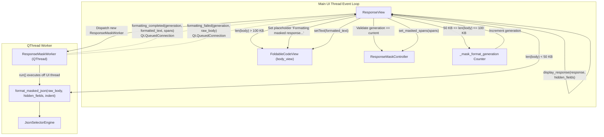
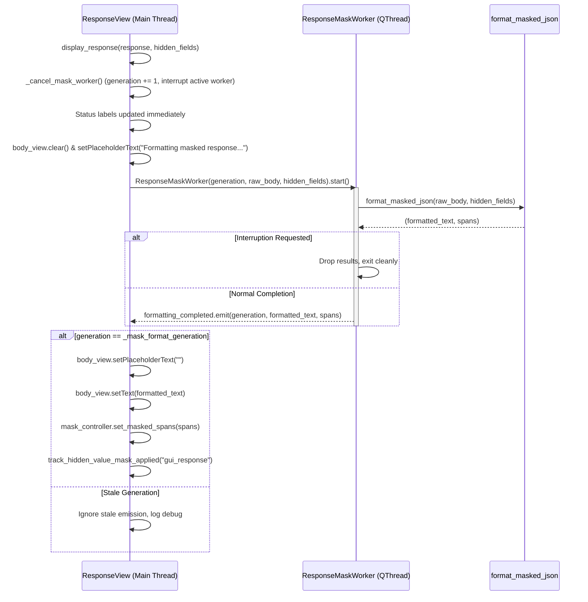

# Background Worker Thread Formatting for Medium JSON Response Masking (PYPOST-1396)

## Overview

In PyPost, response payloads frequently contain sensitive values such as authentication tokens, passwords, private API keys, and Personally Identifiable Information (PII). Through the [Hidden Response Fields](hidden_response_fields.md) subsystem (Epic [PYPOST-1312](https://pypost.atlassian.net/browse/PYPOST-1312)), PyPost automatically masks sensitive response fields in the desktop viewer ([`ResponseView`](file:///home/src/pypost/ui/widgets/response_view.py#L49-L517)), displaying interactive masked placeholders (`"***"`) with click-to-reveal toggling while preserving underlying response integrity.

### The UI Responsiveness Challenge

Displaying masked JSON requires parsing the raw payload into an AST, evaluating path selectors via [`JsonSelectorEngine`](file:///home/src/pypost/core/json_selector_engine.py), formatting indented JSON text, and tracking exact character offset boundaries ([`MaskedTokenSpan`](file:///home/src/pypost/ui/widgets/response_mask_controller.py#L21-L32)).

While small payloads process in under 5 ms and very large payloads bypass formatting entirely, medium-sized payloads (50 KB – 100 KB) present a severe performance challenge:
- AST parsing, selector evaluation, string formatting, and token coordinate tracking for payloads containing hundreds of lines and nested structures require **15–60+ ms** of CPU computation.
- Executing this workload synchronously on the main Qt user interface thread blocks the event loop, dropping frame rates below the 60 FPS target (16.6 ms frame budget) and causing stutter, dropped clicks, and unresponsive tab navigation.

### The Asynchronous Worker Solution

Introduced in **PYPOST-1396**, [`ResponseMaskWorker`](file:///home/src/pypost/ui/widgets/response_mask_worker.py#L19-L141) offloads JSON formatting and token span discovery for medium-sized payloads to a dedicated background [`QThread`](file:///home/src/pypost/ui/widgets/response_mask_worker.py#L19-L141). This decouples CPU-intensive parsing from the UI event loop, keeping typing, scrolling, and window management completely smooth.

---

## Operating Bands & Threshold Routing

PyPost partitions response body presentation across three distinct size bands:

| Size Band | Payload Size Range | Execution Path | Formatting & Masking Behavior | UI Thread Impact |
| :--- | :--- | :--- | :--- | :--- |
| **Small** | `< 50 KB`<br/>(`< MEDIUM_DOC_CHAR_THRESHOLD`) | Synchronous inline | Formatted JSON with click-to-reveal masked token spans via [`format_masked_json`](file:///home/src/pypost/ui/widgets/response_mask_controller.py#L149-L215). | Negligible (<5 ms). Sub-frame latency. |
| **Medium** | `50 KB – 100 KB`<br/>(`50 * 1024` to `100 * 1024` chars) | Background [`ResponseMaskWorker`](file:///home/src/pypost/ui/widgets/response_mask_worker.py#L19-L141) | Formatted JSON with click-to-reveal masked token spans computed off-thread; results applied via Qt signal. | Zero blocking. UI remains 60 FPS interactive. |
| **Large** | `> 100 KB`<br/>(`> LARGE_DOC_CHAR_THRESHOLD`) | Bypass raw path | Raw payload displayed directly; AST parsing, pretty-printing, and token span tracking bypassed to protect editor memory. | Zero parsing overhead. Immediate display. |

### Threshold Constants

The threshold constants are defined in [`response_view.py`](file:///home/src/pypost/ui/widgets/response_view.py#L42-L43):

```python
MEDIUM_DOC_CHAR_THRESHOLD = 50 * 1024  # 51,200 characters (~50 KB)
LARGE_DOC_CHAR_THRESHOLD = 100 * 1024  # 102,400 characters (~100 KB)
```

---

## Architecture & Concurrency Design

### System Concurrency Flow



### Core Components

#### 1. `ResponseMaskWorker` ([`response_mask_worker.py`](file:///home/src/pypost/ui/widgets/response_mask_worker.py#L19-L141))

A dedicated [`QThread`](file:///home/src/pypost/ui/widgets/response_mask_worker.py#L19-L141) subclass designed to execute formatting and token span calculations in background thread space:

- **Parameters**:
  - `generation: int`: Monotonically increasing revision counter used to detect stale results.
  - `raw_body: str`: Raw JSON response string to format.
  - `hidden_fields: Sequence[str]`: Sequence of field selectors (e.g. `["token", "user.password"]`).
  - `indent: int`: JSON indentation size (defaults to 2).
  - `parent: QObject | None`: Parent `QObject` (typically `None` so worker lifecycle is detached from widget hierarchy).

- **Signals**:
  - `formatting_completed = Signal(int, str, list)`: Emitted on success with `(generation, formatted_text, spans)`.
  - `formatting_failed = Signal(int, str)`: Emitted if formatting raises an exception with `(generation, raw_body)`.

- **GC Protection (`_LIVE_WORKERS`)**:
  Python garbage collection can collect a `QThread` instance whose reference is dropped on the Python side while the underlying OS thread is still executing, leading to Qt fatal aborts (`QThread: Destroyed while thread is still running`).
  To prevent this, `ResponseMaskWorker` maintains a class-level registry:
  ```python
  _LIVE_WORKERS: ClassVar[set[ResponseMaskWorker]] = set()
  ```
  Every new instance registers itself in `_LIVE_WORKERS` in `__init__`. It registers slot listeners for `finished` and `destroyed` to safely discard itself from `_LIVE_WORKERS` once thread execution terminates.

- **Cooperative Cancellation**:
  Implements cooperative interruption through `requestInterruption()` and `isInterruptionRequested()`. The worker checks interruption:
  1. Immediately upon entering `run()`.
  2. Immediately after `format_masked_json(...)` returns before emitting signals.
  3. Inside the exception handler before emitting failure signals.
  If interruption was requested, signals are suppressed and a debug log is recorded (`response_mask_worker_cancelled`).

- **Event-Loop Pumping `wait()`**:
  Overridden `wait(*args, **kwargs)` inspects the calling thread. If called from the main application thread (`QThread.currentThread() == app.thread()`), it pumps pending Qt events (`QApplication.processEvents()`) to prevent deadlock conditions during test teardown or synchronous joins:
  ```python
  def wait(self, *args: Any, **kwargs: Any) -> bool:
      res = super().wait(*args, **kwargs)
      app = QApplication.instance()
      if app is not None and QThread.currentThread() == app.thread():
          app.processEvents()
      return res
  ```

- **Teardown Destructor (`__del__`)**:
  Guards against dangling threads during object destruction by requesting interruption and waiting up to 1000 ms if the thread is still running and not self-referenced.

---

## Signal Contracts & UI Integration in `ResponseView`

### Integration Lifecycle in [`ResponseView`](file:///home/src/pypost/ui/widgets/response_view.py#L411-L517)



### Preemption and Generation Tracking

To handle rapid successive response arrivals (e.g. user triggers requests rapidly, switches tabs, or clears the view), [`ResponseView`](file:///home/src/pypost/ui/widgets/response_view.py) tracks `_mask_format_generation: int`:

1. **Preemption on New Response / Clear**:
   Whenever `display_response()` or `clear_body()` is invoked, `_cancel_mask_worker()` is called:
   ```python
   def _cancel_mask_worker(self) -> None:
       self._mask_format_generation += 1
       if self._mask_worker is not None:
           if self._mask_worker.isRunning():
               self._mask_worker.requestInterruption()
           self._mask_worker = None
   ```
2. **Discarding Stale Results**:
   When `_on_mask_formatting_completed` or `_on_mask_formatting_failed` receives an emission from a background worker:
   ```python
   if generation != self._mask_format_generation:
       logger.debug(
           "response_masking_worker_stale_result_ignored generation=%d current_generation=%d",
           generation,
           self._mask_format_generation,
       )
       return
   ```
   Obsolete background tasks can never overwrite the view or corrupt the display state of a newer response.

### Failure Fallback

If an unhandled exception occurs in `ResponseMaskWorker` (e.g. severely malformed payload that triggers unexpected parser faults), the worker emits `formatting_failed(generation, raw_body)`.
In [`_on_mask_formatting_failed`](file:///home/src/pypost/ui/widgets/response_view.py#L499-L517):
- Validates generation match.
- Clears placeholder text.
- Displays raw response body via `self.body_view.setText(raw_body)`.
- Logs a structured warning (`response_masking_async_failed_fallback`).
- Ensures folding scanning runs via `ensure_scanned()`.
The application never crashes or hangs on bad inputs.

---

## Security Invariants

The background masking pipeline enforces strict security guarantees to protect sensitive credentials during screen shares and recordings:

### 1. Zero Visual Secret Flash

> [!IMPORTANT]
> Raw unmasked response text is **never** placed into `FoldableCodeView` while waiting for background formatting to complete.

If the editor were populated with raw unmasked text while `ResponseMaskWorker` was in-flight, sensitive tokens (API keys, customer PII) would flash visibly on screen for 15–60 ms before the worker completed.
To prevent this vulnerability:
- `body_view.clear()` is called immediately on dispatch.
- `body_view.setPlaceholderText("Formatting masked response...")` displays a neutral loading state.
- Status bar labels (`status_label`, `time_label`, `size_label`) update immediately to provide instant execution feedback.
- Only after the worker returns successfully does `setText(formatted_text)` populate the view with tokens already masked.

### 2. Zero Secret Log Leakage

> [!CAUTION]
> Never log raw JSON bodies, AST nodes, or unredacted token values at any log level.

All structured logging across `ResponseMaskWorker` and `ResponseView` records only non-sensitive diagnostic metadata:
- Monotonic generation IDs (`generation=%d`)
- Payload lengths in characters (`chars=%d`)
- Selector counts (`selectors_count=%d`)
- Discovered span counts (`spans=%d`)
- Execution durations in seconds (`duration=%.4fs`)
- Exception class names (`error=%s`)

### 3. Pristine ResponseData Immutability

The underlying in-memory [`ResponseData`](file:///home/src/pypost/models/response.py) instance and request history remain completely pristine. Masking is strictly a presentation-layer transformation applied for visual display.

---

## Observability & Metrics

### Structured Debug and Warning Logs

| Event | Level | Module | Format / Fields |
| :--- | :--- | :--- | :--- |
| **Worker Dispatched** | `DEBUG` | `response_view` | `response_masking_worker_dispatched generation=%d chars=%d selectors_count=%d` |
| **Worker Started** | `DEBUG` | `response_mask_worker` | `response_mask_worker_started generation=%d chars=%d selectors_count=%d` |
| **Interruption Requested** | `DEBUG` | `response_mask_worker` | `response_mask_worker_interruption_requested generation=%d` |
| **Worker Cancelled** | `DEBUG` | `response_mask_worker` | `response_mask_worker_cancelled generation=%d chars=%d` |
| **Worker Completed** | `DEBUG` | `response_mask_worker` | `response_mask_worker_completed generation=%d spans=%d duration=%.4fs` |
| **Worker Failed** | `WARNING` | `response_mask_worker` | `response_mask_worker_failed generation=%d chars=%d duration=%.4fs error=%s` |
| **Async Completed** | `DEBUG` | `response_view` | `response_masking_async_completed generation=%d span_count=%d` |
| **Stale Result Ignored** | `DEBUG` | `response_view` | `response_masking_worker_stale_result_ignored generation=%d current_generation=%d` |
| **Stale Failure Ignored**| `DEBUG` | `response_view` | `response_masking_worker_stale_failure_ignored generation=%d current_generation=%d` |
| **Async Fallback** | `WARNING` | `response_view` | `response_masking_async_failed_fallback generation=%d chars=%d` |
| **Large Doc Fallback** | `DEBUG` | `response_view` | `response_masking_large_doc_fallback payload_size=%d threshold=%d` |

### OpenTelemetry / Prometheus Metrics

When masked spans are applied from `ResponseMaskWorker` (matching the synchronous path), [`ResponseView`](file:///home/src/pypost/ui/widgets/response_view.py#L490-L492) increments the counter:
```python
if spans:
    self._metrics.track_hidden_value_mask_applied("gui_response")
```
This tracks the cumulative count of presentation masking operations across the desktop application lifetime.

---

## Developer Testing Patterns & Guidelines

Automated verification for `ResponseMaskWorker` resides in [`tests/test_response_mask_worker.py`](file:///home/src/tests/test_response_mask_worker.py#L1-L673).

### Test Suite Structure

The suite covers 13 targeted tests across contract, lifecycle, threshold, parity, preemption, and security:

1. **`test_worker_class_definition_and_lifecycle`**: Verifies inheritance (`QThread`, `QObject`), signal signatures (`formatting_completed`, `formatting_failed`), and `_LIVE_WORKERS` registry tracking.
2. **`test_worker_off_thread_execution_and_signal_emission`**: Asserts that `worker.run()` executes on a distinct OS thread ID (`QThread.currentThread() != main_thread`) and emits `formatting_completed`.
3. **`test_worker_cooperative_interruption`**: Verifies `requestInterruption()` suppresses signal emissions when interrupted before completion.
4. **`test_worker_malformed_json_emits_failure`**: Verifies invalid JSON payloads emit `formatting_failed` with the raw input string.
5. **`test_threshold_constants_and_dispatch_boundaries`**: Asserts correct 3-way path dispatch:
   - `< 50 KB`: No worker created (`_mask_worker is None`).
   - `50 KB – 100 KB`: Background worker dispatched (`_mask_worker is not None`).
   - `> 100 KB`: Bypassed directly to raw text without worker or formatting.
6. **`test_medium_payload_formatting_and_masking_equivalence`**: Asserts 100% character-for-character equivalence between background worker output and direct synchronous `format_masked_json` output.
7. **`test_click_to_reveal_on_async_masked_payload`**: Verifies click-to-reveal toggles masked tokens to plain text and back in documents populated asynchronously by `ResponseMaskWorker`.
8. **`test_preemption_and_cancellation_on_rapid_responses`**: Verifies that when a newer response arrives before worker 1 finishes, worker 1 is cancelled, generation increments, and worker 1's results are dropped.
9. **`test_clear_body_cancels_in_flight_worker`**: Asserts `clear_body()` cancels in-flight workers and leaves the editor blank.
10. **`test_malformed_json_in_medium_payload_falls_back_to_raw`**: Tests that malformed JSON in a medium-sized payload falls back to displaying raw unmasked text safely.
11. **`test_observability_logging_and_zero_secret_leakage`**: Asserts completion logs are emitted without secret strings appearing in log records.
12. **`test_observability_cancellation_logs_and_zero_leakage`**: Asserts cancellation logs are emitted without secret strings.
13. **`test_observability_failure_warning_logs_and_zero_leakage`**: Asserts warning logs on failure without secret strings.

### Asynchronous Testing Guidelines

When writing or extending tests for background workers:

1. **Mandatory Timeout Markers**:
   All test files must declare a top-level module timeout marker per repository rules:
   ```python
   pytestmark = pytest.mark.timeout(30)
   ```
2. **Deterministic Waiting via `process_until`**:
   Never use bare `time.sleep()`. Use bounded event processing loops:
   ```python
   from tests.helpers.process_until import process_until

   assert process_until(lambda: view._mask_worker is None, timeout=5000)
   ```
3. **Thread Join Teardown**:
   Always wait for running workers before test exit to avoid Qt thread termination warnings:
   ```python
   if view._mask_worker is not None:
       view._mask_worker.wait(2000)
   ```

---

## Related Documentation & Cross-References

- [Hidden Response Fields Architecture & Decomposition](hidden_response_fields.md): Overall architecture of response masking in desktop GUI and MCP agents (Epic PYPOST-1312).
- [Unified JSON Selector Path Evaluation Engine](json_selector_engine.md): AST selector evaluation engine matching sensitive keys (PYPOST-1394).
- [Background Folding Scanner for Large Documents](background_folding_scanner.md): Reference implementation for asynchronous `QThread` document scanning and generation tracking (PYPOST-1370).
- [Shared Foldable Plain Text Edit Base Class](foldable_plain_text_edit.md): Gutter, font metrics, and viewport architecture for `FoldableCodeView`.
- [Testing Guidelines](testing.md): PyPost test execution standards, GUI fixtures, and timeout constraints.
