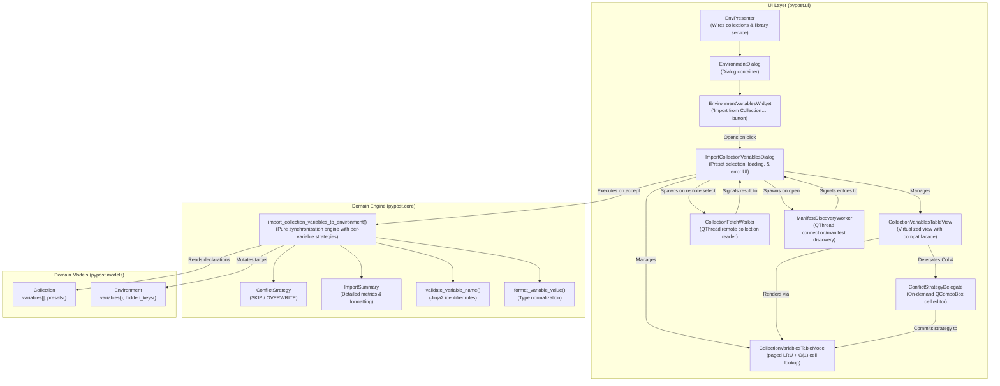

# Workspace Environment Variable Import from Collections

## Overview

As part of epic [PYPOST-1407](https://pypost.atlassian.net/browse/PYPOST-1407) and child tasks
[PYPOST-1411](https://pypost.atlassian.net/browse/PYPOST-1411) and
[PYPOST-1414](https://pypost.atlassian.net/browse/PYPOST-1414), PyPost provides a direct, secure, and
user-friendly bridge between collection-scoped variable declarations and workspace environments.

Following the transition to self-contained collections in
[PYPOST-1409](collection_scoped_variables.md), each [`Collection`](file:///home/src/pypost/models/models.py)
authoritatively declares its required variables ([`CollectionVariable`](file:///home/src/pypost/models/collection_variable.py)),
data types, default values, documentation descriptions, secret flags, and preset profiles.
The workspace environment variable import feature enables users to inspect any available collection
(from active workspace collections or connected library catalogs), choose a configuration preset,
select individual variables, inspect differences side-by-side, resolve collisions via fine-grained
per-variable conflict policies, and safely import them into target workspace environments with
automatic dual-source secret protection.

---

## Architecture

The import workflow is structured into three distinct layers:

1. **Domain Engine (`pypost.core.collection_variable_import`)**:
   Pure Python business logic, completely decoupled from Qt widgets. Handles preset value resolution,
   data type serialization, identifier validation, collision detection, per-variable and batch conflict
   strategies, and secret masking assignment.
2. **Interactive UI (dialog + extracted virtualization modules, PYPOST-1423)**:
   `ImportCollectionVariablesDialog`
   (`pypost.ui.dialogs.import_collection_variables_dialog`) orchestrates source/preset
   selection, dedicated discovery status UI, remote fetch loading/error chrome, and
   import acceptance. Virtualization pieces live in dedicated modules:
   `CollectionVariablesTableModel` (`pypost.ui.models`), `CollectionVariablesTableView`
   (`pypost.ui.views`), `ConflictStrategyDelegate` (`pypost.ui.delegates`),
   `CollectionFetchWorker`, and `ManifestDiscoveryWorker` (`pypost.ui.workers`). The
   dialog re-exports these symbols for backward-compatible imports. Startup library
   catalog discovery is asynchronous (PYPOST-1424) with a dedicated status container
   and error banner completely separated from remote collection fetch chrome
   (PYPOST-1450) so dialog open stays instant, responsive, and free of false error states.
   The UI provides a 9-column side-by-side diff table (Select, Name, Current Value,
   Candidate Value, Conflict Strategy, Type, Secret, Status, Description) with per-row
   and bulk conflict strategies and dual-source secret masking.
3. **Widget & Presenter Integration (`pypost.ui.widgets.environments`)**:
   `EnvironmentVariablesWidget` embeds the "Import from Collection…" button
   (`COLLECTION_VARIABLE_IMPORT_BUTTON`), orchestrates dialog invocation, handles user cancellation,
   and refreshes variable tables upon acceptance. The parent `EnvironmentDialog` and `EnvPresenter`
   wire collections and connected library services into the view.

### Component Relationship



---

## Domain Logic & API Reference

### `import_collection_variables_to_environment`

Located in `pypost/core/collection_variable_import.py`:

```python
def import_collection_variables_to_environment(
    environment: Environment,
    collection: Collection,
    conflict_strategy: ConflictStrategy = ConflictStrategy.SKIP,
    selected_keys: set[str] | None = None,
    preset_name: str | None = None,
    variable_conflict_strategies: dict[str, ConflictStrategy] | None = None,
) -> ImportSummary:
```

- **`environment`**: Target working [`Environment`](file:///home/src/pypost/models/models.py) instance to mutate.
- **`collection`**: Source [`Collection`](file:///home/src/pypost/models/models.py) providing declared variables and presets.
- **`conflict_strategy`**: Default conflict policy for preexisting keys (`ConflictStrategy.SKIP` or `ConflictStrategy.OVERWRITE`). Used as the fallback when a colliding variable is not present in `variable_conflict_strategies`.
- **`selected_keys`**: Optional set of variable names to selectively import. If `None`, all candidate variables are processed.
- **`preset_name`**: Optional preset profile name. If specified and present in `collection.presets`, preset values override base default values.
- **`variable_conflict_strategies`**: Optional mapping of variable names to specific `ConflictStrategy` (`ConflictStrategy.SKIP` or `ConflictStrategy.OVERWRITE`). When specified for a colliding key, this per-variable strategy takes precedence over the default `conflict_strategy`.
- **Returns**: An `ImportSummary` detailing added, updated, skipped, and invalid variables.

### Conflict Resolution Strategies (`ConflictStrategy`)

The enum `ConflictStrategy` defines two deterministic policies when a variable name already exists in `environment.variables`:

| Strategy | Enum Value | Behavior |
| --- | --- | --- |
| **`SKIP`** | `"skip"` | **Non-destructive (default)**. Preserves the current environment value; candidate variable is not imported and added to `summary.skipped_keys`. |
| **`OVERWRITE`** | `"overwrite"` | Replaces the existing environment value with the collection default or preset value, recording the key in `summary.updated_keys`. |

#### Per-Variable Strategy Precedence

When resolving collisions during import:
1. **Explicit Per-Variable Strategy**: If `variable_conflict_strategies` is provided and contains the colliding variable key (`var.name in variable_conflict_strategies`), the engine resolves the conflict strictly according to `variable_conflict_strategies[var.name]`.
2. **Default Strategy Fallback**: If a colliding key is not specified in `variable_conflict_strategies` (or if `variable_conflict_strategies` is `None`), the resolution falls back to the default `conflict_strategy` parameter (which defaults to `ConflictStrategy.SKIP`).
3. **Non-Colliding Variables**: Variables that do not exist in `environment.variables` are imported as new variables (`summary.added_keys`) regardless of conflict strategy settings.

### Import Result (`ImportSummary`)

A dataclass tracking all granular mutation metrics:

```python
@dataclass
class ImportSummary:
    added_keys: list[str] = field(default_factory=list)
    updated_keys: list[str] = field(default_factory=list)
    skipped_keys: list[str] = field(default_factory=list)
    invalid_keys: list[tuple[str, str]] = field(default_factory=list)
    newly_hidden_keys: set[str] = field(default_factory=set)

    @property
    def total_imported(self) -> int:
        return len(self.added_keys) + len(self.updated_keys)

    def format_summary(self) -> str:
        ...
```

`format_summary()` generates human-readable feedback for user notification dialogs
(e.g., `"Imported 3 variable(s) (2 added, 1 updated, 1 skipped)."`).

### Value Formatting & Normalization

Environment variables store string values in `Environment.variables: dict[str, str]`.
The helper `format_variable_value(value: Any) -> str` handles type normalization:

- `None` $\rightarrow$ `""`
- `bool` $\rightarrow$ `"true"` or `"false"` (lowercase JSON style)
- `dict` / `list` $\rightarrow$ serialized as compact JSON string (`json.dumps(value)`)
- Primitive types (int, float, str) $\rightarrow$ `str(value)`

---

## Presets Evaluation

Collections can define multiple environment preset profiles under `collection.presets: dict[str, dict[str, Any]]`
(for instance, `"Staging"`, `"Production"`, `"Local"`).

1. When `preset_name` is `None` or `"(Base Defaults)"`, values resolve to `var.default`.
2. When a valid preset is selected, candidate values are looked up via `collection.presets[preset_name].get(var.name, var.default)`.
   If a variable is not specified in the chosen preset, it gracefully falls back to `var.default`.
3. In `ImportCollectionVariablesDialog`, switching the **Preset Profile** combo box immediately updates
   the value preview column for all rows, re-evaluating secret masks dynamically.

---

## Variable Name Validation Rules

All imported variable names are validated using `pypost.core.variable_name_validation.validate_variable_name`:

- **Jinja2 Compatibility**: Must match identifier regex `^[a-zA-Z_][a-zA-Z0-9_]*$`.
- Cannot be empty or start with a digit.
- Cannot contain whitespace, hyphens, or special punctuation.

### Invalid Name Handling
If a declared collection variable possesses an invalid identifier:
- It is **never** injected into `environment.variables`.
- A warning log is emitted: `collection_variable_import_invalid_key`.
- The key and its validation error are captured in `ImportSummary.invalid_keys`.
- The remaining valid variables in the batch continue processing without interruption.

---

## Secret Protection Policies

Security is enforced at multiple layers:

1. **Automatic Hidden Mapping**:
   If `var.secret is True` on [`CollectionVariable`](file:///home/src/pypost/models/collection_variable.py):
   - The key is automatically added to `environment.hidden_keys`.
   - The key is recorded in `summary.newly_hidden_keys`.
2. **Mutual Exclusion Invariant**:
   In accordance with PyPost security contracts, hidden variables cannot be overridden by MCP tools.
   The import engine explicitly discards the key from `environment.mcp_overridable_keys`.
3. **Dual-Source Secret Masking in Diff Inspector**:
   Within `ImportCollectionVariablesDialog`, values in both the **Current Value** and **Candidate Value**
   columns are masked with `HIDDEN_MASK` (`"********"`) whenever the variable is marked secret in
   either source:
   - Source collection declaration: `var.secret is True`
   - Target workspace environment: `var.name in environment.hidden_keys`
   Plaintext secrets and credentials are never exposed in either column of the diff table.
4. **Encryption at Rest**:
   When saved via `StorageManager`, keys listed in `environment.hidden_keys` are encrypted
   using the active encryption envelope before writing to disk.
5. **Observability Guardrail**:
   Log events emit key names, collision counts, and secret flags, but **never** log raw or decrypted variable values.

---

## UI Components & Virtualized Architecture

### `EnvironmentVariablesWidget`

Located in `pypost/ui/widgets/environments/environment_variables_widget.py`:

- **Import Trigger**: A dedicated `QPushButton("Import from Collection…")` with widget ID
  `COLLECTION_VARIABLE_IMPORT_BUTTON` is positioned alongside the MCP checkbox.
- **Enablement Lifecycle**: The button is enabled when a target environment is actively loaded
  (`load_environment(env)` with `env is not None`) and disabled when no environment is selected.
- **Dependency Injection**: Accepts `get_collections: Callable[[], Iterable[Collection]] | None`
  and `library_service: Any | None` to discover import sources.
- **Execution Workflow**:
  1. Opens modal `ImportCollectionVariablesDialog(target_environment=env, ...)`.
  2. If accepted (`QDialog.DialogCode.Accepted`), calls `self.load_environment(env)` to refresh the table.
  3. Displays an information box with `summary.format_summary()` if variables were imported.

---

### `ImportCollectionVariablesDialog`

Located in `pypost/ui/dialogs/import_collection_variables_dialog.py`:

- **Source Discovery & Dedicated Status UI (PYPOST-1424, PYPOST-1450)**:
  - Populates workspace collections from `workspace_collections` synchronously during
    `__init__` so the dialog paints immediately.
  - Discovers catalog collections asynchronously via `ManifestDiscoveryWorker`, which
    calls `library_service.list_connections()` and
    `library_service.list_manifest_collections()` off the UI thread and appends combo
    entries when complete (PYPOST-1424).
  - Displays catalog discovery progress and errors in a dedicated discovery status UI
    (`discovery_container`, `discovery_error_container`) positioned directly below the
    source dropdowns, leaving the remote collection fetch loading chrome
    (`loading_container`, `error_container`) completely unpolluted (PYPOST-1450).
- **9-Column Side-by-Side Diff Table Layout (`IMPORT_COLLECTION_VARS_TABLE`)**:
  Columns: `[Select, Name, Current Value, Candidate Value, Conflict Strategy, Type, Secret, Status, Description]`
  - *Select* (col 0): Interactive row checkboxes allowing users to cherry-pick which variables to import.
  - *Name* (col 1): Collection variable identifier.
  - *Current Value* (col 2): Displays the existing value in `environment.variables` (or `"—"` if new). Masked with `HIDDEN_MASK` (`"********"`) if marked secret in either collection or destination environment.
  - *Candidate Value* (col 3): Displays the incoming value resolved from the selected preset (or base defaults). Dynamically updates on preset switch, masked with `HIDDEN_MASK` if secret in either source.
  - *Conflict Strategy* (col 4): For colliding keys (`Status == "Exists (Collision)"`), renders an interactive `QComboBox` (`IMPORT_COLLECTION_ROW_STRATEGY_COMBO_PREFIX<key>`) with options `"Keep Current"` (`ConflictStrategy.SKIP`, default) and `"Overwrite"` (`ConflictStrategy.OVERWRITE`). For non-colliding keys (`Status == "New"`), displays a non-interactive dash (`"—"`).
  - *Type* (col 5): Declared data type badge (`string`, `number`, `boolean`, `json`).
  - *Secret* (col 6): Secret flag (`Yes` or `No`).
  - *Status* (col 7): Collision status (`"Exists (Collision)"` if present in `environment.variables`, or `"New"`).
  - *Description* (col 8): Variable documentation / description string.
- **Bulk Collision & Selection Controls**:
  - `Select All` / `Deselect All` buttons (`IMPORT_COLLECTION_SELECT_ALL_BUTTON`, `IMPORT_COLLECTION_DESELECT_ALL_BUTTON`).
  - `Keep All Collisions` button (`IMPORT_COLLECTION_BULK_KEEP_CURRENT_BUTTON`): sets all colliding row strategy combo boxes to `"Keep Current"`.
  - `Overwrite All Collisions` button (`IMPORT_COLLECTION_BULK_OVERWRITE_BUTTON`): sets all colliding row strategy combo boxes to `"Overwrite"`.
- **Dynamic Preview Summary Label**:
  Shows real-time import preview reflecting active row selections and chosen strategies:
  `"{will_add} new to add, {will_overwrite} existing to overwrite, {will_keep} existing to keep"`.

---

### `CollectionVariablesTableModel(QAbstractTableModel)`

Located in `pypost/ui/models/collection_variables_table_model.py` (extracted in
[PYPOST-1423](https://pypost.atlassian.net/browse/PYPOST-1423); still re-exported from the
dialog module).

Prior to [PYPOST-1415](https://pypost.atlassian.net/browse/PYPOST-1415), the import table allocated persistent `QTableWidgetItem` instances and individual `QComboBox` widgets across thousands of rows. This caused severe UI thread blocking (several seconds), high memory consumption, and sluggish scrolling.

`CollectionVariablesTableModel` is a pure virtualized Qt table model. As of
[PYPOST-1427](https://pypost.atlassian.net/browse/PYPOST-1427) it binds the
collection variable catalog by reference and materializes
`CollectionVariableRowRecord` instances in LRU chunks instead of eagerly
allocating one record per variable:

```python
CHUNK_SIZE = 256
MAX_CACHED_CHUNKS = 8  # ≤ 2048 materialized records

@dataclass
class CollectionVariableRowRecord:
    name: str
    current_display: str
    candidate_display: str
    raw_current: Any
    raw_candidate: Any
    var_default: Any
    strategy: ConflictStrategy
    var_type: str
    is_collection_secret: bool
    is_env_secret: bool
    is_effective_secret: bool
    is_collision: bool
    status: str
    description: str
    is_selected: bool = True
```

Selection and conflict-strategy mutations live in sparse overlays (defaults +
per-row overrides) so chunk eviction never loses import decisions.
`cached_record_count` reports the current materialized window size.

#### Key Architecture & Characteristics

1. **Zero Persistent Widget Allocation**:
   Renders 10,000+ variables with zero persistent `QComboBox` or cell widget overhead.
2. **Paged / Cursor Materialization (PYPOST-1427)**:
   `load_collection()` resets overlays and clears the chunk cache without building
   `N` records (instant initial load). `data()` / `get_record()` ensure the owning
   chunk (`CHUNK_SIZE` rows) is present; least-recent chunks evict when the cache
   exceeds `MAX_CACHED_CHUNKS`. Model record overhead stays bounded (sub-10MB target
   for the cache window) for 50k–100k catalogs.
3. **$O(1)$ Cell Evaluation after materialization**:
   Within a cached chunk, cell formatting and secret masking are stored on the
   record; subsequent `data()` calls are direct index lookups.
4. **Dual-Source Secret Masking**:
   During record generation, both collection declaration (`var.secret`) and target environment (`var.name in env.hidden_keys`) are checked. If either is true, `current_display` and `candidate_display` are masked with `HIDDEN_MASK` (`"********"`). Tooltips for sensitive cells are suppressed to prevent accidental disclosure via mouse hover.
5. **Native Check State Handling**:
   Column 0 (`COL_SELECT`) responds to `Qt.ItemDataRole.CheckStateRole`, returning `Qt.CheckState.Checked` or `Qt.CheckState.Unchecked` based on `rec.is_selected`. Toggling emits `selection_changed` without re-rendering unrelated cells.
6. **High-Performance Bulk Operations**:
   - `set_all_selected(selected: bool)`: Sets the selection default, clears overrides, patches cached records, and emits a single bounding `dataChanged(..., [CheckStateRole])`.
   - `set_all_collision_strategy(strategy: ConflictStrategy)`: Sets the strategy default, clears overrides, patches cached collision records, and emits columnar `dataChanged` on strategy cells.
7. **Preset Switching**:
   `update_preset(preset_name)` updates preset value maps, invalidates the chunk
   cache (candidates rematerialize on next access), and emits a columnar
   `dataChanged` across `COL_CANDIDATE_VALUE` without resetting the model.

---

### `ConflictStrategyDelegate(QStyledItemDelegate)`

Located in `pypost/ui/delegates/conflict_strategy_delegate.py` (PYPOST-1423).

`ConflictStrategyDelegate` manages on-demand strategy editing for column 4 (`COL_STRATEGY`):

- **On-Demand Instantiation (`createEditor`)**:
  When a user double-clicks or interacts with a colliding cell, `createEditor()` instantiates a single temporary `QComboBox` parented to the viewport.
  - Non-colliding rows (`Status == "New"`) are marked non-editable via `flags()` and cannot open editors.
  - Widget ID is bound dynamically: `set_widget_id(combo, f"{IMPORT_COLLECTION_ROW_STRATEGY_COMBO_PREFIX}{rec.name}")`.
- **Commit & Teardown Lifecycle**:
  - `combo.currentIndexChanged` triggers `commitAndCloseEditor()`.
  - `commitAndCloseEditor()` emits `commitData(combo)` followed by `closeEditor(combo, NoHint)`.
  - `setModelData()` maps the selected text (`"Keep Current"` or `"Overwrite"`) to `ConflictStrategy.SKIP` or `ConflictStrategy.OVERWRITE` and updates the model via `model.setData()`.
  - Upon editor closure, the combobox widget is destroyed. Zero persistent widgets remain in memory.

---

### `CollectionVariablesTableView` (Backward-Compatibility Facade)

Located in `pypost/ui/views/collection_variables_table_view.py` (PYPOST-1423).

To ensure backward compatibility with existing tests and integration code expecting `QTableWidget` APIs, `CollectionVariablesTableView` subclasses `QTableView` and exposes a facade layer:

- **`.item(row, col) -> TableItemProxy`**:
  Returns a lightweight proxy wrapping model coordinates that mimics `QTableWidgetItem`:
  - `.text()` $\rightarrow$ queries `model.data(DisplayRole)`.
  - `.setText(val)` $\rightarrow$ calls `model.setData(DisplayRole)`.
  - `.checkState()` $\rightarrow$ queries `model.data(CheckStateRole)`.
  - `.setCheckState(state)` $\rightarrow$ calls `model.setData(CheckStateRole)`.
  - `.flags()` $\rightarrow$ queries `model.flags()`.
- **`.cellWidget(row, col) -> QWidget | None`**:
  For column 4 (`COL_STRATEGY`) on colliding rows, returns a cached, synchronized `QComboBox` widget. This allows automated tests expecting `cellWidget()` combobox interactions to inspect and trigger strategy selections without modification.
- **`.rowCount() -> int` and `.columnCount() -> int`**:
  Forwarded directly to underlying model counts.
- **`.horizontalHeaderItem(col) -> HeaderItemProxy`**:
  Returns a proxy exposing `.text()` derived from `model.headerData()`.
- **Signal Forwarding**:
  Listens to `model.dataChanged` and emits `itemChanged(proxy)` to support legacy event listeners.

---

### `ManifestDiscoveryWorker(QThread)` & Async Catalog Discovery

Located in `pypost/ui/workers/manifest_discovery_worker.py` (PYPOST-1424).

Enumerating library connections and remote manifests during dialog `__init__` used to
block the UI thread. `ManifestDiscoveryWorker` moves that work off-thread:

```python
class ManifestDiscoveryWorker(QThread):
    discovery_completed = Signal(object, int)  # (list[(label, userData)], generation_id)
    discovery_failed = Signal(Exception, int)
```

1. When `library_service` is provided, `__init__` calls `_start_manifest_discovery()`.
2. The worker lists connections and per-connection manifest collections off-thread,
   passing a `CancellationToken` so cancel can abort listing I/O (PYPOST-1425).
3. On success, the dialog appends combo entries while preserving the prior selection
   index (so Qt’s empty-combo auto-select does not swallow a later `setCurrentIndex(0)`).
4. Failures show the dedicated inline discovery error banner (`discovery_error_container`);
   `retry_discovery_btn` restarts discovery independently from collection fetching.
   Cancel (`cancel_discovery_btn`) / close / accept invalidate `_discovery_generation`
   and cancel the discovery worker (token abort + interruption) without affecting
   active collection fetches or fetch chrome (PYPOST-1450).

### `CollectionFetchWorker(QThread)` & Background Remote Fetching

Located in `pypost/ui/workers/collection_fetch_worker.py` (PYPOST-1423).

Reading a selected remote collection can incur network latency. Running that on the Qt
GUI thread risks freezing the application.

`CollectionFetchWorker` moves remote library collection retrieval to a background `QThread`:

```python
class CollectionFetchWorker(QThread):
    fetch_completed = Signal(object, int)  # (Collection, generation_id)
    fetch_failed = Signal(Exception, int)   # (Exception, generation_id)
```

#### Off-Thread Retrieval Workflow

1. When a library collection is selected, `_start_fetch_remote_collection(conn_id, path)` starts a new `CollectionFetchWorker`.
2. The worker calls `library_service.read_collection(conn_id, path, cancellation_token=...)`
   off-thread (token omitted only for legacy services that reject the keyword).
3. Upon completion or failure, the worker emits `fetch_completed` or `fetch_failed` alongside its `generation_id`.
   `OperationCancelledError` from transport abort is treated as a quiet interrupt (no
   `fetch_failed` signal).

#### Race Protection via Monotonic Generation Counter (`_fetch_generation`)

If a user rapidly changes the collection dropdown or triggers multiple requests, responses may return out of order. To prevent race conditions:

- `ImportCollectionVariablesDialog` maintains a monotonic counter `self._fetch_generation: int`.
- Every new fetch request, cancellation, or reset increments `_fetch_generation`.
- When `_on_fetch_completed` or `_on_fetch_failed` fires, the incoming `gen` is checked against `self._fetch_generation`.
- If `gen != self._fetch_generation`, the response is recognized as stale, safely discarded, and logged with `collection_variable_remote_fetch_stale_discarded`.

#### Worker Cancellation & Transport Abort (PYPOST-1425)

- When a new collection is selected or the user clicks "Cancel", `self._active_fetch_worker.cancel()` is called.
- `cancel()` sets `_cancelled = True`, calls `self.requestInterruption()`, and cancels the
  worker's `CancellationTokenSource` so registered transport abort callbacks run
  immediately (e.g. socket/session close).
- `LibraryManagerService.read_collection` / `list_connections` /
  `list_manifest_collections` accept an optional `cancellation_token` and raise
  `OperationCancelledError` at cooperative checkpoints.
- The worker checks interruption status before emitting signals; cancelled workers do not emit completion or failure events.
- Generation discard remains a secondary safety net; transport abort is the primary stop.
- Prior to PYPOST-1450, discovery shared the fetch Cancel control. In PYPOST-1450,
  discovery cancel is routed through the dedicated `cancel_discovery_btn` and
  `_on_cancel_discovery()`. `ManifestDiscoveryWorker` implements the same cooperative
  `CancellationToken` abort pattern as `CollectionFetchWorker`, allowing in-flight
  connection listing or manifest retrieval to be interrupted promptly on cancel.

#### Nested Cancellation Propagation & Duck-Typed Dispatch (PYPOST-1452)

While PYPOST-1425 introduced transport abort signals and top-level cooperative checkpoints
for workers, nested helpers historically dropped outer cancellation tokens. This allowed
nested `get_connection()` calls to perform uncancellable store reloads or disk scans before
the next checkpoint was reached. **PYPOST-1452** completes end-to-end token forwarding
across `LibraryManagerService`, `LibraryCollectionImportService`, and `LibraryPresenter`:

1. **`LibraryManagerService` Nested Token Propagation**:
   - `get_connection(stable_id, cancellation_token=None)`: Accepts an optional
     `cancellation_token`, checks for cancellation both before and after listing, forwards
     the token to `list_connections(cancellation_token=cancellation_token)`, and logs
     `library_manager_get_connection_cancelled` when interrupted.
   - `read_manifest(stable_id, cancellation_token=None)`: Accepts `cancellation_token`,
     checks cooperative cancellation, forwards the token into `self.get_connection(...)`,
     and logs `library_manager_read_manifest_cancelled` upon cancellation.
   - `list_manifest_collections(stable_id, cancellation_token=None)`: Forwards
     `cancellation_token` to `self.get_connection(stable_id, cancellation_token=...)`.
   - `read_collection(stable_id, relative_path, cancellation_token=None)`: Forwards
     `cancellation_token` to `self.get_connection(stable_id, cancellation_token=...)`.

2. **`LibraryCollectionImportService` Helper Propagation & Duck-Typing**:
   - `_connections(cancellation_token=None)`: Accepts `cancellation_token` and invokes
     `list_connections` via `call_with_cancellation_token(...)`. This duck-typing wrapper
     safely injects the token when supported while preserving full backward compatibility
     with legacy test doubles and third-party managers that do not accept keyword arguments.
   - `_find_connection(stable_id, cancellation_token=None)`: Passes `cancellation_token`
     to `_connections(...)` and uses `call_with_cancellation_token(...)` when invoking
     `get_connection(...)`.
   - Public entry points (`list_entries`, `resolve_entries`, `import_entries`,
     `resolve_link`, `refresh_linked_collection`): Accept and forward `cancellation_token`
     through the helper call chain.

3. **`LibraryPresenter` Safe Token Forwarding**:
   - `get_connection_record(library_id=None, cancellation_token=None)`: Accepts optional
     `cancellation_token` and safely delegates to `manager_service.get_connection` via
     `call_with_cancellation_token(...)`.

#### Adaptive Worker Teardown & Polymorphic Thread Join (PYPOST-1453)

Prior to PYPOST-1453, dialog cancellation and dismissal (`reject()`, `closeEvent()`, `accept()`)
as well as collection switching invoked rigid `wait(1000)` blocking calls on background
`QThread` worker instances (`ManifestDiscoveryWorker` and `CollectionFetchWorker`). Even when
workers exited immediately (<50ms), or when worker objects adhered to duck-typed thread
interfaces, rigid joins created unnecessary UI freezing or risked unhandled attribute errors.

**PYPOST-1453** centralizes worker cancellation and teardown using adaptive polling joins:

1. **Polymorphic Thread Duck-Typing in `adaptive_thread_join` (`pypost/core/cancellation.py`)**:
   - `adaptive_thread_join` accepts polymorphic thread objects, seamlessly supporting both
     standard library `threading.Thread` instances (using `is_alive()` and `join(timeout=...)`)
     and PySide6 `QThread` instances (or test doubles implementing `isRunning()` / `is_running()`
     or inverted `isFinished()`, and `wait(msecs)`).
   - Private helpers `_is_thread_alive(thread)` and `_slice_join(thread, slice_timeout)` abstract
     lifecycle queries and slice timeouts, automatically converting fractional seconds into
     integer milliseconds when calling Qt `wait(msecs)`.
   - `_resolve_thread_name(thread, thread_name)` resolves human-readable thread identifiers
     from explicit overrides, `thread.name`, `thread.objectName()`, or `type(thread).__name__`.

2. **Centralized Worker Teardown in `ImportCollectionVariablesDialog`**:
   - `_cancel_and_join_worker(worker, name="Worker", timeout=1.0)`: Central helper that signals
     worker cancellation (`worker.cancel()`, `requestInterruption()`) and executes
     `adaptive_thread_join(worker, timeout=timeout, thread_name=name)`.
   - `_cancel_discovery_worker(timeout=1.0)`: Clears and adaptively joins `_active_discovery_worker`.
   - `_cancel_fetch_worker(timeout=1.0)`: Clears and adaptively joins `_active_fetch_worker`.
   - Replaced all hardcoded `wait(1000)` calls across `reject()`, `closeEvent()`, and `accept()`
     with centralized teardown helpers.
   - Guarded collection switches (`_on_collection_changed`, `_start_remote_fetch`) to cancel
     superseded fetch workers adaptively before spawning new tasks.

3. **Latency Profile and Diagnostic Observability**:
   - **Fast-Path Return**: Quickly-exiting workers unblock the main UI thread in <50ms.
   - **Bounded Ceiling**: Unresponsive workers or blocking network I/O are bounded by a 1.0s
     deadline, preventing application hangs during dialog closure.
   - **Timeout Warning Diagnostics**: When a worker exceeds the join deadline,
     `adaptive_thread_join` logs a structured warning (`Thread did not terminate within timeout:
     thread=%s elapsed=%.3fs timeout=%.3fs is_alive=%s`), facilitating troubleshooting of stuck
     worker threads.

#### Slow-Drip / Delayed-Success Remote Read Invariants (PYPOST-1457)

High-latency or throttled network connections can cause remote collection reads to stream
data slowly over several seconds before completing cleanly. During this delayed-success
interval, `ImportCollectionVariablesDialog` and `CollectionFetchWorker` enforce strict
concurrency invariants to ensure predictable UX, zero false error states, and responsive UI:

1. **Persistent Loading Chrome & Action Invalidation**:
   - `loading_container` remains visible throughout the drip with
     `"Loading collection from library..."`.
   - Content-dependent controls (`preset_combo`, `vars_table`, `import_button`) remain disabled.
   - The virtualized table model renders 0 rows until data collection completes; no partial or
     malformed candidate rows are displayed mid-stream.
2. **Spurious Error Suppression**:
   - `error_container` is strictly suppressed while data drips and upon delayed clean completion.
   - Slow transfer latency is never misclassified as a timeout or network fault.
3. **Accurate Eventual Table Population**:
   - Upon completion, `loading_container` hides, table and presets enable, and all candidate
     variables populate matching their declared types, presets, and dual-source secret masks.
   - Import summary preview reflects correct candidate counts (`add`, `overwrite`, `keep`).
   - If the remote collection defines 0 variables, the table displays a clean empty state with
     the Import button disabled and no error banner.
4. **Prompt Cooperative Cancellation (< 0.5s)**:
   - Clicking `cancel_loading_btn` requests worker interruption and signals the
     `CancellationToken`.
   - Slicing delay loops abort immediately upon `cancellation_token.wait()`, raising
     `OperationCancelledError` without waiting out the full delay budget.
   - Cancellation completes in < 0.5s (`ABORT_ELAPSED_LIMIT_S = 0.5s`), increments
     `_fetch_generation`, hides loading chrome, and leaves the table empty without false errors.
5. **Selection Supersession & Monotonic Generation Discard**:
   - Selecting a new collection while a slow read is in-flight increments `_fetch_generation`
     and cancels the active worker.
   - When the superseded worker eventually terminates, its completion signal is recognized as
     stale (`gen != _fetch_generation`), quietly discarded, and logged with
     `collection_variable_remote_fetch_stale_discarded`.
   - The table displays only data from the newly selected collection.
6. **Dialog Teardown & Polymorphic Join (< 1.0s)**:
   - Dismissing the dialog (`reject()`, `closeEvent()`) while a drip is active cancels the
     worker and joins it adaptively via `_cancel_fetch_worker()` and `adaptive_thread_join()`.
   - Teardown unblocks promptly (< 1.0s), leaving zero lingering background threads or
     orphaned callbacks directed at destroyed widgets.
7. **UI Responsiveness Guarantees (< 50ms latency)**:
   - Remote streaming executes off-thread in `CollectionFetchWorker`.
   - The main Qt event loop processes events smoothly with event processing latency < 50ms,
     preventing UI freezes or unresponsive window states.

#### Slicing Delay Simulation (`SlowDripSimulator`)

Automated testing of delayed-success reads without live network dependencies is provided by
`SlowDripSimulator` and `slow_drip_collection_side_effect` in
`tests/helpers/remote_collection_faults.py`:

```python
sim = slow_drip_collection_side_effect(
    collection=remote_col,
    total_delay_s=0.35,
    slice_interval_s=0.02,
    max_duration_s=5.0,
)
```

- **Slicing Loop**: Instead of an uninterruptible `time.sleep()`, `SlowDripSimulator` executes
  a sliced delay loop using `cancellation_token.wait(timeout=self.slice_interval_s)`.
- **Cooperative Abort**: When cancellation is requested mid-drip, `wait()` unblocks instantly
  and raises `OperationCancelledError("Slow drip aborted during slice")`, setting
  `self.cancelled`.
- **Deterministic Synchronization**: Exposes `entered`, `completed`, and `cancelled`
  `threading.Event` primitives and counts `slices_elapsed`, allowing test fixtures to verify
  in-flight invariants deterministically before unblocking.

---

### Non-Modal Status Containers, Error Handling, and Retry (PYPOST-1450, PYPOST-1451)

Previous dialog workflows relied on modal error message boxes (`QMessageBox.critical`) that
blocked execution and disrupted user focus. Prior to PYPOST-1450, manifest discovery and remote
collection fetch shared inline status containers (`loading_container`, `error_container`), which
caused cross-pollinated state, premature hiding when switching collections, and ambiguous cancel
and retry triggers.

In PYPOST-1450 and PYPOST-1451, manifest discovery and remote collection fetch chrome are completely
separated into distinct UI containers, dedicated slots, and decoupled state machines with automated
failure, retry, cancellation, and isolation coverage:

1. **Dedicated Discovery Status UI (`discovery_container`)**:
   - Contains `discovery_label` ("Discovering library collections...") and
     `cancel_discovery_btn` ("Cancel").
   - Widget IDs: `IMPORT_COLLECTION_DISCOVERY_CONTAINER`, `IMPORT_COLLECTION_DISCOVERY_LABEL`,
     and `IMPORT_COLLECTION_CANCEL_DISCOVERY_BUTTON`.
   - Displayed non-modally below `source_layout` during catalog discovery.
   - Non-blocking: Workspace collections remain immediately interactive; table inspection,
     preset switching, and the Import button are never disabled by catalog discovery.
2. **Dedicated Discovery Error UI (`discovery_error_container`)**:
   - Contains `discovery_error_label` (styled in red with discovery error text) and
     `retry_discovery_btn` ("Retry").
   - Widget IDs: `IMPORT_COLLECTION_DISCOVERY_ERROR_CONTAINER`,
     `IMPORT_COLLECTION_DISCOVERY_ERROR_LABEL`, and `IMPORT_COLLECTION_RETRY_DISCOVERY_BUTTON`.
   - Displayed non-modally when `ManifestDiscoveryWorker` fails. Keeps the dialog open and
     functional for workspace collections without polluting the fetch error container.
   - **Error Label Reset Contract (PYPOST-1451)**: `discovery_error_label` is guaranteed to be
     cleared via `setText("")` across every discovery start and recovery transition:
     `_start_manifest_discovery()` on initial launch, `_on_retry_discovery()` when a retry is
     dispatched, and `_on_discovery_completed()` when discovery succeeds. This contract prevents
     obsolete error strings from persisting into successful or pending states (consolidating
     these transitions into a single UI state helper is tracked in
     [PYPOST-1516](https://pypost.atlassian.net/browse/PYPOST-1516)).
3. **Dedicated Remote Collection Fetch Loading Chrome (`loading_container`)**:
   - Contains `loading_label` ("Loading collection from library...") and `cancel_loading_btn`.
   - Widget IDs: `IMPORT_COLLECTION_LOADING_CONTAINER`, `IMPORT_COLLECTION_LOADING_LABEL`, and
     `IMPORT_COLLECTION_CANCEL_LOADING_BUTTON`.
   - Shown exclusively when a user selects a remote catalog collection. Disables the Import
     button, preset dropdown, and variable table while keeping Cancel active.
4. **Dedicated Remote Collection Fetch Error Chrome (`error_container`)**:
   - Contains `error_label` (styled in red with fetch failure details) and `retry_fetch_btn`.
   - Widget IDs: `IMPORT_COLLECTION_ERROR_CONTAINER`, `IMPORT_COLLECTION_ERROR_LABEL`, and
     `IMPORT_COLLECTION_RETRY_FETCH_BUTTON`.
   - Displayed non-modally when remote collection retrieval or deserialization fails.
5. **Decoupled State Machines & Dedicated Slots**:
   - **Cancellation Slots**:
     - `_on_cancel_discovery()`: Triggered by `cancel_discovery_btn`. Increments
       `_discovery_generation`, signals cancellation to `_active_discovery_worker`, and hides
       `discovery_container` and `discovery_error_container`. Does not cancel `_active_fetch_worker`
       or mutate `loading_container`.
     - `_on_cancel_loading()`: Triggered by `cancel_loading_btn`. Increments `_fetch_generation`,
       signals cancellation to `_active_fetch_worker`, hides `loading_container`, and resets the
       table. Does not cancel `_active_discovery_worker` or touch discovery containers.
   - **Retry Slots**:
     - `_on_retry_discovery()`: Triggered by `retry_discovery_btn`. Restarts discovery via
       `_start_manifest_discovery()`. Never triggers collection fetch.
     - `_on_retry_fetch()`: Triggered by `retry_fetch_btn`. Restarts collection fetch for the
       selected remote collection via `_start_fetch_remote_collection()`. Never restarts discovery.
   - **Collection Switching**:
     - Selecting a workspace collection in `_on_collection_changed()` resets only fetch chrome
       (`loading_container`, `error_container`), leaving discovery running or displaying its
       dedicated status strip.
6. **Catalog Discovery Failure, Retries, and Isolation (PYPOST-1451)**:
   - **Network & OS Fault Resiliency**: Enumeration handles `ConnectionResetError`,
     `TimeoutError`, `BrokenPipeError`, and `OSError` in `ManifestDiscoveryWorker` without
     crashing the UI thread, surfacing recoverable inline error banners.
   - **Mid-Stream Traversal Errors**: If `list_connections` succeeds but a connection fails
     during `list_manifest_collections`, the worker safely aborts traversal and discards
     partial results to prevent corrupted catalog dropdown listings (fault-tolerant
     partial catalog traversal is tracked in
     [PYPOST-1515](https://pypost.atlassian.net/browse/PYPOST-1515)).
   - **End-to-End Fail-Then-Recover Lifecycle**: Clicking `retry_discovery_btn` dispatches a fresh
     discovery worker run, resets the error label contract, displays the discovery spinner
     container, and upon success populates catalog collections while hiding the error container.
   - **Stale Generation Discard on Rapid Retries**: Successive clicks on `retry_discovery_btn`
     increment `_discovery_generation`. Delayed completions or errors from superseded worker
     runs are dropped via `collection_variable_manifest_discovery_stale_discarded` and
     `collection_variable_manifest_discovery_error_stale_discarded`.
   - **Cooperative Cancellation During Fault State**: Clicking `cancel_discovery_btn` while
     in a fault state hides the error UI, sets worker cancellation flags, and invokes
     `requestInterruption()` so late failures do not trigger false UI states.
   - **Workspace Collection Isolation**: Local workspace collections remain 100% operational
     when discovery errors occur; variable diff inspection, preset switching, strategy selection,
     and imports into the target environment are completely unaffected.
   - **Dialog Teardown & Worker Join**: Dialog close / reject aborts in-flight discovery and
     performs an adaptive thread join via `adaptive_thread_join` (elimination of rigid `wait(1000)`
     blocking calls completed in [PYPOST-1453](https://pypost.atlassian.net/browse/PYPOST-1453);
     forwarding cancellation tokens into connection providers completed in
     [PYPOST-1452](https://pypost.atlassian.net/browse/PYPOST-1452); large-scale high-concurrency
     discovery tests tracked in [PYPOST-1517](https://pypost.atlassian.net/browse/PYPOST-1517)).
7. **Flaky network and corrupted manifests (PYPOST-1426)**:
   - The same inline error + Retry path covers `ConnectionResetError`, `BrokenPipeError`,
     truncated JSON (`CollectionSerializationError`), and malformed variable schemas raised
     from `read_collection` / deserialization.
   - Failed fetches clear the table model so partial or corrupt payloads are never shown.
   - Cancel during a mid-stream blocked read still uses transport abort (PYPOST-1425) and
     must not present a fetch-failure banner for the cancelled generation.
   - Automated coverage: `tests/test_remote_collection_fault_injection_repro.py` with helpers
     in `tests/helpers/remote_collection_faults.py`.
8. **Slow-drip streaming and delayed-success invariants (PYPOST-1457)**:
   - While PYPOST-1426 characterized hard faults (network drop, corrupted JSON, schema mismatch),
     PYPOST-1457 characterizes slow-drip streaming reads that dribble data before succeeding.
   - Proves loading chrome persistence, zero false error popups or banners during streaming,
     prompt cooperative cancellation (< 0.5s), selection supersession with stale signal
     discard, clean dialog teardown (< 1.0s), and UI event loop responsiveness (< 50ms latency).
   - Automated coverage: `tests/test_remote_collection_slow_drip_repro.py` using slicing delay
     helpers from `tests/helpers/remote_collection_faults.py`.

---

## Structured Observability

Logger channel names follow each module's `__name__` after PYPOST-1423 (for example
`pypost.ui.models.collection_variables_table_model` for model events and
`pypost.ui.workers.collection_fetch_worker` for worker events). Event *message* names
below are unchanged.

The subsystem emits structured log events conforming to the repository logging policy:

| Event Name | Level | Parameters | Purpose |
| --- | --- | --- | --- |
| `collection_variable_import_started` | INFO | `env_name`, `collection_name`, `preset`, `conflict_strategy`, `selected_keys_count` | Domain engine execution start |
| `collection_variable_import_completed` | INFO | `env_name`, `collection_name`, `total`, `added`, `updated`, `skipped`, `invalid`, `newly_hidden` | Domain engine success metrics |
| `collection_variable_import_invalid_key` | WARNING | `env_name`, `collection_name`, `key`, `error` | Invalid identifier skipped |
| `collection_variable_import_failed` | ERROR | `env_name`, `collection_name`, `error` | Unexpected failure during import |
| `env_import_from_collection_clicked` | INFO | `env_name`, `available_collections_count` | UI import button triggered |
| `env_collection_variables_imported` | INFO | `env_name`, `collection_name`, `total`, `added`, `updated`, `skipped`, `invalid` | Dialog accepted & imported |
| `collection_variable_import_dialog_opened` | INFO | `env_name` | Dialog opened |
| `collection_variable_import_dialog_accepted` | INFO | `env_name`, `collection_name`, `preset`, `selected_count`, `collisions`, `overwrite_collisions`, `keep_collisions` | User confirmed import |
| `collection_variable_import_dialog_cancelled` | INFO | `env_name` | User cancelled dialog |
| `collection_variable_import_table_populated` | DEBUG | `env_name`, `collection_name`, `total_vars`, `collisions` | Diff table populated |
| `collection_variable_import_row_strategy_changed` | DEBUG | `env_name`, `key`, `strategy` | User modified individual row strategy |
| `collection_variable_import_bulk_strategy_applied` | INFO | `env_name`, `strategy`, `count` | Bulk collision action triggered |
| `collection_variable_fetch_worker_started` | DEBUG | `generation_id`, `connection_id`, `path` | Background worker thread started |
| `collection_variable_fetch_worker_completed` | DEBUG | `generation_id` | Worker fetched collection successfully |
| `collection_variable_fetch_worker_failed` | WARNING | `generation_id`, `error` | Worker encountered fetch error |
| `collection_variable_fetch_worker_cancelled` | DEBUG | `generation_id`, `connection_id` | Worker cancel method invoked |
| `collection_variable_fetch_worker_interrupted` | DEBUG | `generation_id` | Worker aborted due to interruption |
| `collection_variable_fetch_worker_transport_aborted` | DEBUG | `generation_id`, `error` | Transport abort raised `OperationCancelledError` |
| `collection_variable_manifest_discovery_worker_started` | DEBUG | `generation_id` | Discovery worker thread started |
| `collection_variable_manifest_discovery_worker_completed` | DEBUG | `generation_id`, `entry_count` | Discovery worker finished successfully |
| `collection_variable_manifest_discovery_worker_failed` | WARNING | `generation_id`, `error` | Discovery worker encountered error |
| `collection_variable_manifest_discovery_worker_cancelled` | DEBUG | `generation_id` | Discovery worker cancel invoked |
| `collection_variable_manifest_discovery_worker_interrupted` | DEBUG | `generation_id` | Discovery worker aborted due to interruption |
| `collection_variable_manifest_discovery_worker_transport_aborted` | DEBUG | `generation_id`, `error` | Discovery transport abort raised `OperationCancelledError` |
| `collection_variable_manifest_discovery_started` | INFO | `gen` | Background catalog discovery worker started |
| `collection_variable_manifest_discovery_completed` | INFO | `gen`, `entry_count` | Discovery finished and combo entries populated |
| `collection_variable_manifest_discovery_failed` | WARNING | `gen`, `error` | Catalog discovery failed (recoverable warning) |
| `collection_variable_manifest_discovery_cancelled` | INFO | `gen` | User cancelled active catalog discovery |
| `collection_variable_manifest_discovery_retry_requested` | INFO | `env_name` | User clicked Retry discovery button |
| `collection_variable_manifest_discovery_stale_discarded` | WARNING | `gen`, `current_gen` | Stale completed discovery dropped |
| `collection_variable_manifest_discovery_error_stale_discarded` | WARNING | `gen`, `current_gen`, `error` | Stale discovery error response dropped |
| `collection_variable_remote_fetch_started` | INFO | `connection_id`, `path`, `gen` | UI initiated background fetch |
| `collection_variable_remote_fetch_completed` | INFO | `gen`, `collection_name`, `vars_count` | Remote fetch finished and loaded |
| `collection_variable_remote_fetch_failed` | ERROR | `gen`, `error` | Remote fetch failed |
| `collection_variable_remote_fetch_cancelled` | INFO | `gen` | User cancelled active fetch |
| `collection_variable_remote_fetch_retry_requested` | INFO | `env_name` | User clicked Retry button |
| `collection_variable_remote_fetch_stale_discarded` | WARNING | `gen`, `current_gen` | Stale completed fetch dropped |
| `collection_variable_remote_fetch_error_stale_discarded` | WARNING | `gen`, `current_gen`, `error` | Stale error response dropped |
| `collection_variables_table_model_loaded` | DEBUG | `collection_name`, `row_count`, `collisions`, `preset` | Model loaded collection records |
| `collection_variables_table_model_strategy_changed` | DEBUG | `row`, `var_name`, `strategy` | Model updated row strategy |
| `collection_variables_table_model_bulk_strategy_set` | DEBUG | `strategy`, `affected_rows`, `total_rows` | Bulk strategy applied in model |
| `conflict_strategy_delegate_committed` | DEBUG | `row`, `strategy` | Delegate committed combo choice |

---

### Decoupled Discovery vs Fetch Observability (PYPOST-1450)

Prior to PYPOST-1450, catalog discovery and remote collection fetching shared logging
paths and generic error handling, producing ambiguous telemetry. The pipelines are now
completely decoupled:

1. **Independent Event Prefixes**:
   - Catalog discovery emits `collection_variable_manifest_discovery_*`.
   - Remote collection fetch emits `collection_variable_remote_fetch_*`.
2. **Dedicated Severity Levels**:
   - Discovery failures are logged at `WARNING` with exception traceback (`exc_info=True`).
     Catalog discovery failure is non-fatal and recoverable; local workspace collections
     remain fully functional and importable.
   - Remote collection fetch failures are logged at `ERROR` with exception traceback
     (`exc_info=True`). The user explicitly requested a collection that failed to load.
3. **Independent Generation Tracking**:
   - `_discovery_generation` tracks discovery freshness. Stale completions or errors
     emit `collection_variable_manifest_discovery_stale_discarded` or
     `collection_variable_manifest_discovery_error_stale_discarded`.
   - `_fetch_generation` tracks remote collection fetch freshness. Stale completions or
     errors emit `collection_variable_remote_fetch_stale_discarded` or
     `collection_variable_remote_fetch_error_stale_discarded`.
4. **Zero Secret Leakage**:
   - Variable values and defaults are never emitted in cleartext logs. Only structural
     metadata (`gen`, `env_name`, `connection_id`, `path`, `entry_count`, `vars_count`)
     is recorded.

---

## Troubleshooting & FAQ

- **Why are my existing variable values not updating?**
  Check the Conflict Strategy column in the dialog. The default strategy for colliding variables is `Keep Current`,
  which safely preserves current environment values. Select `Overwrite` for individual rows or click
  `Overwrite All Collisions` to replace them with incoming candidate values.
- **Why is a variable not being imported?**
  Ensure the variable name is a valid Python/Jinja2 identifier (starts with a letter or underscore, alphanumeric only).
  Check the log output for `collection_variable_import_invalid_key`.
- **Are secret values exposed during side-by-side diff inspection?**
  No. Secret variables display `HIDDEN_MASK` (`"********"`) in both Current Value and Candidate Value columns
  if marked secret in either the collection or the destination environment. Credentials are automatically
  registered in `environment.hidden_keys` upon import.
- **Can I import variables from an external connected library?**
  Yes. The Source Collection dropdown automatically queries connected libraries via `LibraryManagerService`.
  Selecting a library collection loads its parsed variables without copying the collection to your workspace.
- **What happens if a remote library fetch fails?**
  An inline error message with a "Retry" button is displayed in the dialog without blocking popups. You can click "Retry"
  to attempt fetching again or select another collection from the dropdown.

---

## Testing

Automated test coverage is maintained in:

- `tests/test_discovery_status_ui_repro.py` (PYPOST-1450):
  - **Dedicated Discovery Status UI**: Asserts presence and initial hidden state of
    `discovery_container`, `discovery_label`, `cancel_discovery_btn`,
    `discovery_error_container`, `discovery_error_label`, and `retry_discovery_btn`
    with registered IDs in `pypost/ui/widget_ids.py`.
  - **Fetch Loading Chrome Isolation**: Verifies active manifest discovery displays
    `discovery_container` and sets `discovery_label` without mutating or revealing
    `loading_container`.
  - **Fetch Error Chrome Isolation**: Verifies discovery failure displays
    `discovery_error_container` with `discovery_error_label` without mutating,
    revealing, or polluting `error_container`.
  - **Independent Cancellation Slots**: Verifies `cancel_discovery_btn` triggers
    `_on_cancel_discovery` to cancel discovery without affecting `_active_fetch_worker`
    or `loading_container`, and vice versa for `cancel_loading_btn`.
  - **Independent Retry Slots**: Verifies `retry_discovery_btn` triggers
    `_on_retry_discovery` to restart discovery without triggering remote collection fetch,
    and `retry_fetch_btn` triggers `_on_retry_fetch` for the selected collection.
  - **Concurrent Cancellation Independence**: Verifies independent cancellation when
    both discovery and fetch workers are concurrently active in background threads.
  - **Decoupled Observability Lifecycles**: Enforces emission of independent
    `collection_variable_manifest_discovery_*` (INFO/WARNING) and
    `collection_variable_remote_fetch_*` (INFO/ERROR) structured events with zero
    cross-pipeline pollution.
- `tests/test_async_manifest_discovery_failure_repro.py` (PYPOST-1451):
  - **Fault Injection on `list_connections`**: Injects `ConnectionResetError`,
    `TimeoutError`, `BrokenPipeError`, and `OSError` into connection listing; asserts
    `ManifestDiscoveryWorker` catches exceptions, logs
    `collection_variable_manifest_discovery_worker_failed` and
    `collection_variable_manifest_discovery_failed`, and displays
    `discovery_error_container` with `retry_discovery_btn` enabled while fetch chrome
    stays hidden.
  - **Mid-Stream Traversal Errors on `list_manifest_collections`**: Injects failure on
    manifest listing for secondary connections; verifies worker aborts traversal,
    discards partial results, and surfaces the error banner without leaving half-populated
    catalogs (follow-up [PYPOST-1515](https://pypost.atlassian.net/browse/PYPOST-1515)).
  - **End-to-End Fail-Then-Recover Lifecycle**: Verifies initial discovery failure, user
    retry via `retry_discovery_btn`, error label reset contract (verifying
    `discovery_error_label` text is cleared immediately on retry and completion), and
    successful catalog combo population (follow-up
    [PYPOST-1516](https://pypost.atlassian.net/browse/PYPOST-1516)).
  - **Stale Generation Discard on Rapid Retries**: Triggers rapid discovery retries,
    verifying monotonic `_discovery_generation` counter increments and discard of
    out-of-order completion or failure signals via warning logs.
  - **Cooperative Cancellation During Fault State**: Cancels active discovery via
    `cancel_discovery_btn`; verifies `discovery_container` and `discovery_error_container`
    hide, worker aborts via `CancellationToken` and interruption, and late signals do not
    alter UI state.
  - **Workspace Collection Usability & Isolation**: Asserts that during remote discovery
    failure, local workspace collections remain fully functional: switching collections,
    diff table rendering, preset selection, row/bulk conflict strategies, and target
    environment imports succeed normally.
  - **Clean Worker Thread Termination & Bounded Join**: Closes or rejects dialog during
    active or failing discovery; verifies cooperative worker cancellation, bounded
    adaptive thread join (<50ms fast-path return), and leak-free teardown (completed in
    [PYPOST-1452](https://pypost.atlassian.net/browse/PYPOST-1452) and
    [PYPOST-1453](https://pypost.atlassian.net/browse/PYPOST-1453); follow-up
    [PYPOST-1517](https://pypost.atlassian.net/browse/PYPOST-1517)).
- `tests/test_import_dialog_adaptive_worker_join_repro.py` (PYPOST-1453):
  - **Fast Return Latency on Worker Exit**: Verifies `_cancel_and_join_worker` unblocks in <50ms when workers exit promptly, avoiding rigid blocking delays.
  - **Polymorphic Thread Duck-Typing**: Tests `adaptive_thread_join` across standard `threading.Thread`, PySide6 `QThread`, and duck-typed test doubles supporting either `join`/`is_alive` or `wait`/`isRunning`.
  - **Centralized Teardown on Dialog Actions**: Validates adaptive worker cancellation and teardown during `reject()`, `closeEvent()`, and `accept()`.
  - **Worker Replacement on Collection Switch**: Asserts superseded fetch workers are cooperatively cancelled and adaptively joined when users change collection selection.
  - **Bounded Timeout and Diagnostic Logging**: Validates that stuck workers time out gracefully at the 1.0s boundary and emit structured warning diagnostics.
- `tests/test_forward_cancellation_nested_helpers_repro.py` (PYPOST-1452):
  - **Nested Cancellation in LibraryManagerService**: Asserts `get_connection`, `read_manifest`,
    `list_manifest_collections`, and `read_collection` forward tokens and abort before store
    reloads or manifest disk reads.
  - **Collaborator Duck-Typing in LibraryCollectionImportService**: Asserts `_connections` and
    `_find_connection` safely interact with legacy managers lacking `cancellation_token` kwargs
    via `call_with_cancellation_token`.
  - **Public Import Entry Points**: Asserts `list_entries`, `resolve_entries`, `import_entries`,
    `resolve_link`, and `refresh_linked_collection` propagate tokens down into nested helpers.
  - **Presenter Token Forwarding**: Asserts `LibraryPresenter.get_connection_record` forwards
    cancellation tokens without raising errors on legacy managers.
  - **Observability Diagnostics**: Asserts structured debug logging for
    `library_manager_get_connection_cancelled` and `library_manager_read_manifest_cancelled`.
- `tests/test_async_manifest_discovery_repro.py`:
  - **Non-Blocking Dialog Init** (PYPOST-1424 / PYPOST-1536): Asserts `__init__`
    returns without joining on `list_connections` by gating the mock behind a
    `threading.Event` released only after construction returns (avoids false
    wall-clock failures under parallel CI load). Also asserts
    `_active_discovery_worker` is a `QThread`, `list_connections` runs off the UI
    thread, workspace items appear immediately, and remote entries append after a
    bounded event-loop wait.
- `tests/test_collection_fetch_transport_abort_repro.py`:
  - **Transport Abort on Cancel**: Asserts `CollectionFetchWorker` /
    `ManifestDiscoveryWorker.cancel()` fires `CancellationToken` abort callbacks and
    unblocks in-flight library I/O promptly (does not wait out the full remote budget).
- `tests/test_remote_collection_fault_injection_repro.py` (PYPOST-1426):
  - **Flaky network / TCP reset**: Injects `ConnectionResetError` and `BrokenPipeError`
    from `read_collection`; asserts inline error banner, Retry, empty table (no partial
    rows), and successful retry after reset.
  - **Corrupted manifests**: Feeds truncated JSON and malformed variable schemas through
    real `deserialize_collection_from_json` (via `tests/helpers/remote_collection_faults`);
    asserts recoverable UX and worker `fetch_failed` emission.
  - **Cancel mid-stream**: Combines PYPOST-1425 transport abort with a blocked mid-stream
    read; cancel must abort promptly without a false fetch-failure banner.
- `tests/test_remote_collection_slow_drip_repro.py` (PYPOST-1457):
  - **Loading Chrome & Error Suppression**: Verifies loading container stays visible, action
    controls stay disabled, table shows 0 partial rows, and error container remains suppressed
    during slow-drip reads and upon delayed clean completion.
  - **Eventual Population Matches Schema**: Verifies complete delayed loading of candidate
    variables, types, secret masks (`HIDDEN_MASK`), raw values, presets, and button enablement.
  - **Prompt Cooperative Cancellation**: Asserts mid-stream cancel aborts worker cooperatively
    in < 0.5s, increments fetch generation, hides chrome, and leaves table empty without errors.
  - **Selection Supersession**: Validates switching collection mid-drip cancels active worker,
    discards stale completion signals, and renders only the newly selected collection.
  - **Dialog Close Teardown**: Verifies dialog rejection mid-drip aborts and joins workers
    promptly (< 1.0s) without thread leaks or unhandled callbacks.
  - **Zero Variables Handling**: Asserts delayed collection with 0 variables renders clean empty
    state with disabled import button and zero error warnings.
  - **UI Responsiveness Contract**: Proves Qt event loop latency remains < 50ms during background
    slow-drip streaming.
  - **Structured Observability**: Asserts logging contracts for `remote_fetch_started`,
    `remote_fetch_completed`, `remote_fetch_cancelled`, and `remote_fetch_stale_discarded`.
- `tests/test_collection_variables_paged_model_repro.py` (PYPOST-1427):
  - **Instant extreme load**: 50,000-variable `load_collection` under wall-clock budget with empty cache before first row access.
  - **Bounded chunk cache**: Sparse scroll across many chunks keeps `cached_record_count ≤ CHUNK_SIZE * MAX_CACHED_CHUNKS`.
  - **Eviction-safe decisions**: Selection / strategy overlays and summary counts survive LRU eviction.
  - **Small-catalog parity**: Existing row / bulk strategy behavior for tiny collections.
- `tests/test_variable_import_virtualization_repro.py`:
  - **Zero-Widget Scaling**: Asserts zero persistent cell widgets across 1,000+ variables, verifying virtualized memory and rendering scaling.
  - **Background Collection Fetching**: Verifies `CollectionFetchWorker` executes off-thread without freezing the UI, showing the loading container and cancel button (waits for async discovery first).
  - **Monotonic Generation Counter Race Protection**: Validates that slow or out-of-order responses from superseded fetch operations are safely discarded without overwriting active view state.
  - **Non-Modal Error Handling & Retry**: Validates inline error container display on library fetch failure and verifies retry button triggers a new background worker.
  - **Bulk Conflict Performance**: Benchmarks bulk strategy updates (`Keep All Collisions`, `Overwrite All Collisions`) completing across 1,000+ variables in sub-20ms.
  - **Backward-Compatibility Facade**: Verifies `CollectionVariablesTableView` compatibility methods (`.item()`, `.cellWidget()`, `.rowCount()`, `.columnCount()`, `.horizontalHeaderItem()`, `itemChanged` signal).
- `tests/test_workspace_environment_import_diff_repro.py`:
  - Domain engine per-variable conflict strategy resolution (`variable_conflict_strategies`) and fallback precedence.
  - UI 9-column side-by-side diff table layout and header verification.
  - Dual-source secret masking across `Current Value` and `Candidate Value` columns.
  - Per-row conflict strategy `QComboBox` initialization, defaults (`Keep Current`), and user selection (`Overwrite`).
  - Bulk collision action buttons (`Keep All Collisions`, `Overwrite All Collisions`).
  - Strategy choice persistence across preset switching and per-variable dialog import execution.
- `tests/test_workspace_environment_import_repro.py`:
  - Domain engine unit tests: additions, updates, skip conflicts, overwrite conflicts, selective subset imports.
  - Secret protection & mutual exclusion validation.
  - Preset evaluation & default fallback tests.
  - Name validation guardrails.
  - UI dialog interaction tests: collection switching, preset switching, table population, select/deselect all, dialog accept/reject.
  - `EnvironmentVariablesWidget` button click and integration tests.
- `tests/test_environment_variables_widget.py`:
  - Unit tests for `EnvironmentVariablesWidget` lifecycle, load/unload states, and button enablement.

Run test suite via Make:

```bash
make test
```

