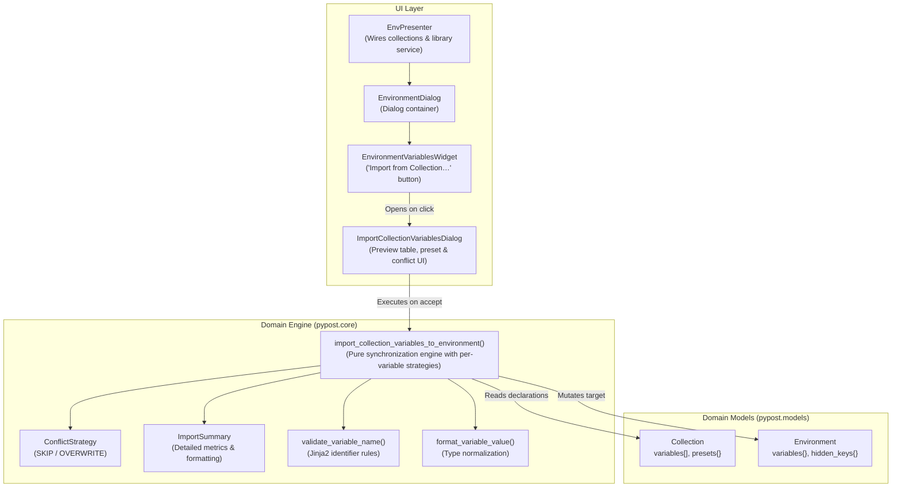

# Workspace Environment Variable Import from Collections

## Overview

As part of epic [PYPOST-1407](https://pypost.atlassian.net/browse/PYPOST-1407) and child tasks
[PYPOST-1411](https://pypost.atlassian.net/browse/PYPOST-1411) and
[PYPOST-1414](https://pypost.atlassian.net/browse/PYPOST-1414), PyPost provides a direct, secure, and
user-friendly bridge between collection-scoped variable declarations and workspace environments.

Following the transition to self-contained collections in
[PYPOST-1409](collection_scoped_variables.md), each [`Collection`](file:///home/src/pypost/models/models.py)
authoritatively declares its required variables ([`CollectionVariable`](file:///home/src/pypost/models/collection_variable.py)),
data types, default values, documentation descriptions, secret flags, and preset profiles.
The workspace environment variable import feature enables users to inspect any available collection
(from active workspace collections or connected library catalogs), choose a configuration preset,
select individual variables, inspect differences side-by-side, resolve collisions via fine-grained
per-variable conflict policies, and safely import them into target workspace environments with
automatic dual-source secret protection.

---

## Architecture

The import workflow is structured into three distinct layers:

1. **Domain Engine (`pypost.core.collection_variable_import`)**:
   Pure Python business logic, completely decoupled from Qt widgets. Handles preset value resolution,
   data type serialization, identifier validation, collision detection, per-variable and batch conflict
   strategies, and secret masking assignment.
2. **Interactive UI (`pypost.ui.dialogs.import_collection_variables_dialog`)**:
   `ImportCollectionVariablesDialog` provides a 9-column side-by-side diff table layout
   (Select, Name, Current Value, Candidate Value, Conflict Strategy, Type, Secret, Status, Description).
   Users can compare existing environment values against incoming candidate values, select per-row
   conflict strategies (`Keep Current` vs `Overwrite`) for colliding keys, trigger bulk collision
   actions, and preview import mutations in real time with dual-source secret masking.
3. **Widget & Presenter Integration (`pypost.ui.widgets.environments`)**:
   `EnvironmentVariablesWidget` embeds the "Import from Collection…" button
   (`COLLECTION_VARIABLE_IMPORT_BUTTON`), orchestrates dialog invocation, handles user cancellation,
   and refreshes variable tables upon acceptance. The parent `EnvironmentDialog` and `EnvPresenter`
   wire collections and connected library services into the view.

### Component Relationship



---

## Domain Logic & API Reference

### `import_collection_variables_to_environment`

Located in `pypost/core/collection_variable_import.py`:

```python
def import_collection_variables_to_environment(
    environment: Environment,
    collection: Collection,
    conflict_strategy: ConflictStrategy = ConflictStrategy.SKIP,
    selected_keys: set[str] | None = None,
    preset_name: str | None = None,
    variable_conflict_strategies: dict[str, ConflictStrategy] | None = None,
) -> ImportSummary:
```

- **`environment`**: Target working [`Environment`](file:///home/src/pypost/models/models.py) instance to mutate.
- **`collection`**: Source [`Collection`](file:///home/src/pypost/models/models.py) providing declared variables and presets.
- **`conflict_strategy`**: Default conflict policy for preexisting keys (`ConflictStrategy.SKIP` or `ConflictStrategy.OVERWRITE`). Used as the fallback when a colliding variable is not present in `variable_conflict_strategies`.
- **`selected_keys`**: Optional set of variable names to selectively import. If `None`, all candidate variables are processed.
- **`preset_name`**: Optional preset profile name. If specified and present in `collection.presets`, preset values override base default values.
- **`variable_conflict_strategies`**: Optional mapping of variable names to specific `ConflictStrategy` (`ConflictStrategy.SKIP` or `ConflictStrategy.OVERWRITE`). When specified for a colliding key, this per-variable strategy takes precedence over the default `conflict_strategy`.
- **Returns**: An `ImportSummary` detailing added, updated, skipped, and invalid variables.

### Conflict Resolution Strategies (`ConflictStrategy`)

The enum `ConflictStrategy` defines two deterministic policies when a variable name already exists in `environment.variables`:

| Strategy | Enum Value | Behavior |
| --- | --- | --- |
| **`SKIP`** | `"skip"` | **Non-destructive (default)**. Preserves the current environment value; candidate variable is not imported and added to `summary.skipped_keys`. |
| **`OVERWRITE`** | `"overwrite"` | Replaces the existing environment value with the collection default or preset value, recording the key in `summary.updated_keys`. |

#### Per-Variable Strategy Precedence

When resolving collisions during import:
1. **Explicit Per-Variable Strategy**: If `variable_conflict_strategies` is provided and contains the colliding variable key (`var.name in variable_conflict_strategies`), the engine resolves the conflict strictly according to `variable_conflict_strategies[var.name]`.
2. **Default Strategy Fallback**: If a colliding key is not specified in `variable_conflict_strategies` (or if `variable_conflict_strategies` is `None`), the resolution falls back to the default `conflict_strategy` parameter (which defaults to `ConflictStrategy.SKIP`).
3. **Non-Colliding Variables**: Variables that do not exist in `environment.variables` are imported as new variables (`summary.added_keys`) regardless of conflict strategy settings.

### Import Result (`ImportSummary`)

A dataclass tracking all granular mutation metrics:

```python
@dataclass
class ImportSummary:
    added_keys: list[str] = field(default_factory=list)
    updated_keys: list[str] = field(default_factory=list)
    skipped_keys: list[str] = field(default_factory=list)
    invalid_keys: list[tuple[str, str]] = field(default_factory=list)
    newly_hidden_keys: set[str] = field(default_factory=set)

    @property
    def total_imported(self) -> int:
        return len(self.added_keys) + len(self.updated_keys)

    def format_summary(self) -> str:
        ...
```

`format_summary()` generates human-readable feedback for user notification dialogs
(e.g., `"Imported 3 variable(s) (2 added, 1 updated, 1 skipped)."`).

### Value Formatting & Normalization

Environment variables store string values in `Environment.variables: dict[str, str]`.
The helper `format_variable_value(value: Any) -> str` handles type normalization:

- `None` $\rightarrow$ `""`
- `bool` $\rightarrow$ `"true"` or `"false"` (lowercase JSON style)
- `dict` / `list` $\rightarrow$ serialized as compact JSON string (`json.dumps(value)`)
- Primitive types (int, float, str) $\rightarrow$ `str(value)`

---

## Presets Evaluation

Collections can define multiple environment preset profiles under `collection.presets: dict[str, dict[str, Any]]`
(for instance, `"Staging"`, `"Production"`, `"Local"`).

1. When `preset_name` is `None` or `"(Base Defaults)"`, values resolve to `var.default`.
2. When a valid preset is selected, candidate values are looked up via `collection.presets[preset_name].get(var.name, var.default)`.
   If a variable is not specified in the chosen preset, it gracefully falls back to `var.default`.
3. In `ImportCollectionVariablesDialog`, switching the **Preset Profile** combo box immediately updates
   the value preview column for all rows, re-evaluating secret masks dynamically.

---

## Variable Name Validation Rules

All imported variable names are validated using `pypost.core.variable_name_validation.validate_variable_name`:

- **Jinja2 Compatibility**: Must match identifier regex `^[a-zA-Z_][a-zA-Z0-9_]*$`.
- Cannot be empty or start with a digit.
- Cannot contain whitespace, hyphens, or special punctuation.

### Invalid Name Handling
If a declared collection variable possesses an invalid identifier:
- It is **never** injected into `environment.variables`.
- A warning log is emitted: `collection_variable_import_invalid_key`.
- The key and its validation error are captured in `ImportSummary.invalid_keys`.
- The remaining valid variables in the batch continue processing without interruption.

---

## Secret Protection Policies

Security is enforced at multiple layers:

1. **Automatic Hidden Mapping**:
   If `var.secret is True` on [`CollectionVariable`](file:///home/src/pypost/models/collection_variable.py):
   - The key is automatically added to `environment.hidden_keys`.
   - The key is recorded in `summary.newly_hidden_keys`.
2. **Mutual Exclusion Invariant**:
   In accordance with PyPost security contracts, hidden variables cannot be overridden by MCP tools.
   The import engine explicitly discards the key from `environment.mcp_overridable_keys`.
3. **Dual-Source Secret Masking in Diff Inspector**:
   Within `ImportCollectionVariablesDialog`, values in both the **Current Value** and **Candidate Value**
   columns are masked with `HIDDEN_MASK` (`"********"`) whenever the variable is marked secret in
   either source:
   - Source collection declaration: `var.secret is True`
   - Target workspace environment: `var.name in environment.hidden_keys`
   Plaintext secrets and credentials are never exposed in either column of the diff table.
4. **Encryption at Rest**:
   When saved via `StorageManager`, keys listed in `environment.hidden_keys` are encrypted
   using the active encryption envelope before writing to disk.
5. **Observability Guardrail**:
   Log events emit key names, collision counts, and secret flags, but **never** log raw or decrypted variable values.

---

## UI Components & Integration

### `EnvironmentVariablesWidget`

Located in `pypost/ui/widgets/environments/environment_variables_widget.py`:

- **Import Trigger**: A dedicated `QPushButton("Import from Collection…")` with widget ID
  `COLLECTION_VARIABLE_IMPORT_BUTTON` is positioned alongside the MCP checkbox.
- **Enablement Lifecycle**: The button is enabled when a target environment is actively loaded
  (`load_environment(env)` with `env is not None`) and disabled when no environment is selected.
- **Dependency Injection**: Accepts `get_collections: Callable[[], Iterable[Collection]] | None`
  and `library_service: Any | None` to discover import sources.
- **Execution Workflow**:
  1. Opens modal `ImportCollectionVariablesDialog(target_environment=env, ...)`.
  2. If accepted (`QDialog.DialogCode.Accepted`), calls `self.load_environment(env)` to refresh the table.
  3. Displays an information box with `summary.format_summary()` if variables were imported.

### `ImportCollectionVariablesDialog`

Located in `pypost/ui/dialogs/import_collection_variables_dialog.py`:

- **Source Discovery**:
  - Populates workspace collections from `workspace_collections`.
  - Populates catalog collections from connected libraries via `library_service.list_connections()`
    and `library_service.list_manifest_collections()`.
- **9-Column Side-by-Side Diff Table Layout (`IMPORT_COLLECTION_VARS_TABLE`)**:
  Columns: `[Select, Name, Current Value, Candidate Value, Conflict Strategy, Type, Secret, Status, Description]`
  - *Select* (col 0): Interactive row checkboxes allowing users to cherry-pick which variables to import.
  - *Name* (col 1): Collection variable identifier.
  - *Current Value* (col 2): Displays the existing value in `environment.variables` (or `"—"` if new). Masked with `HIDDEN_MASK` (`"********"`) if marked secret in either collection or destination environment.
  - *Candidate Value* (col 3): Displays the incoming value resolved from the selected preset (or base defaults). Dynamically updates on preset switch, masked with `HIDDEN_MASK` if secret in either source.
  - *Conflict Strategy* (col 4): For colliding keys (`Status == "Exists (Collision)"`), renders an interactive `QComboBox` (`IMPORT_COLLECTION_ROW_STRATEGY_COMBO_PREFIX<key>`) with options `"Keep Current"` (`ConflictStrategy.SKIP`, default) and `"Overwrite"` (`ConflictStrategy.OVERWRITE`). For non-colliding keys (`Status == "New"`), displays a non-interactive dash (`"—"`).
  - *Type* (col 5): Declared data type badge (`string`, `number`, `boolean`, `json`).
  - *Secret* (col 6): Secret flag (`Yes` or `No`).
  - *Status* (col 7): Collision status (`"Exists (Collision)"` if present in `environment.variables`, or `"New"`).
  - *Description* (col 8): Variable documentation / description string.
- **Per-Row Conflict Strategy Resolution**:
  - Each colliding variable can be independently configured to keep the existing environment value or overwrite with candidate value.
  - User choices in the per-row dropdowns are preserved when switching preset profiles.
- **Bulk Collision & Selection Controls**:
  - `Select All` / `Deselect All` buttons (`IMPORT_COLLECTION_SELECT_ALL_BUTTON`, `IMPORT_COLLECTION_DESELECT_ALL_BUTTON`).
  - `Keep All Collisions` button (`IMPORT_COLLECTION_BULK_KEEP_CURRENT_BUTTON`): sets all colliding row strategy combo boxes to `"Keep Current"`.
  - `Overwrite All Collisions` button (`IMPORT_COLLECTION_BULK_OVERWRITE_BUTTON`): sets all colliding row strategy combo boxes to `"Overwrite"`.
- **Dynamic Preview Summary Label**:
  Shows real-time import preview reflecting active row selections and chosen strategies:
  `"{will_add} new to add, {will_overwrite} existing to overwrite, {will_keep} existing to keep"`.

---

## Structured Observability

The subsystem emits structured log events conforming to the repository logging policy:

| Event Name | Level | Parameters | Purpose |
| --- | --- | --- | --- |
| `collection_variable_import_started` | INFO | `env_name`, `collection_name`, `preset`, `conflict_strategy`, `selected_keys_count` | Domain engine execution start |
| `collection_variable_import_completed` | INFO | `env_name`, `collection_name`, `total`, `added`, `updated`, `skipped`, `invalid`, `newly_hidden` | Domain engine success metrics |
| `collection_variable_import_invalid_key` | WARNING | `env_name`, `collection_name`, `key`, `error` | Invalid identifier skipped |
| `collection_variable_import_failed` | ERROR | `env_name`, `collection_name`, `error` | Unexpected failure during import |
| `env_import_from_collection_clicked` | INFO | `env_name`, `available_collections_count` | UI import button triggered |
| `env_collection_variables_imported` | INFO | `env_name`, `collection_name`, `total`, `added`, `updated`, `skipped`, `invalid` | Dialog accepted & imported |
| `collection_variable_import_dialog_opened` | INFO | `env_name` | Dialog opened |
| `collection_variable_import_dialog_accepted` | INFO | `env_name`, `collection_name`, `preset`, `selected_count`, `collisions`, `overwrite_collisions`, `keep_collisions` | User confirmed import |
| `collection_variable_import_dialog_cancelled` | INFO | `env_name` | User cancelled dialog |
| `collection_variable_import_table_populated` | DEBUG | `env_name`, `collection_name`, `total_vars`, `collisions` | Diff table populated |
| `collection_variable_import_row_strategy_changed` | DEBUG | `env_name`, `key`, `strategy` | User modified individual row strategy |
| `collection_variable_import_bulk_strategy_applied` | INFO | `env_name`, `strategy`, `count` | Bulk collision action triggered |

---

## Troubleshooting & FAQ

- **Why are my existing variable values not updating?**
  Check the Conflict Strategy column in the dialog. The default strategy for colliding variables is `Keep Current`,
  which safely preserves current environment values. Select `Overwrite` for individual rows or click
  `Overwrite All Collisions` to replace them with incoming candidate values.
- **Why is a variable not being imported?**
  Ensure the variable name is a valid Python/Jinja2 identifier (starts with a letter or underscore, alphanumeric only).
  Check the log output for `collection_variable_import_invalid_key`.
- **Are secret values exposed during side-by-side diff inspection?**
  No. Secret variables display `HIDDEN_MASK` (`"********"`) in both Current Value and Candidate Value columns
  if marked secret in either the collection or the destination environment. Credentials are automatically
  registered in `environment.hidden_keys` upon import.
- **Can I import variables from an external connected library?**
  Yes. The Source Collection dropdown automatically queries connected libraries via `LibraryManagerService`.
  Selecting a library collection loads its parsed variables without copying the collection to your workspace.

---

## Testing

Automated test coverage is maintained in:

- `tests/test_workspace_environment_import_diff_repro.py`:
  - Domain engine per-variable conflict strategy resolution (`variable_conflict_strategies`) and fallback precedence.
  - UI 9-column side-by-side diff table layout and header verification.
  - Dual-source secret masking across `Current Value` and `Candidate Value` columns.
  - Per-row conflict strategy `QComboBox` initialization, defaults (`Keep Current`), and user selection (`Overwrite`).
  - Bulk collision action buttons (`Keep All Collisions`, `Overwrite All Collisions`).
  - Strategy choice persistence across preset switching and per-variable dialog import execution.
- `tests/test_workspace_environment_import_repro.py`:
  - Domain engine unit tests: additions, updates, skip conflicts, overwrite conflicts, selective subset imports.
  - Secret protection & mutual exclusion validation.
  - Preset evaluation & default fallback tests.
  - Name validation guardrails.
  - UI dialog interaction tests: collection switching, preset switching, table population, select/deselect all, dialog accept/reject.
  - `EnvironmentVariablesWidget` button click and integration tests.
- `tests/test_environment_variables_widget.py`:
  - Unit tests for `EnvironmentVariablesWidget` lifecycle, load/unload states, and button enablement.

Run test suite via Make:

```bash
make test
```
